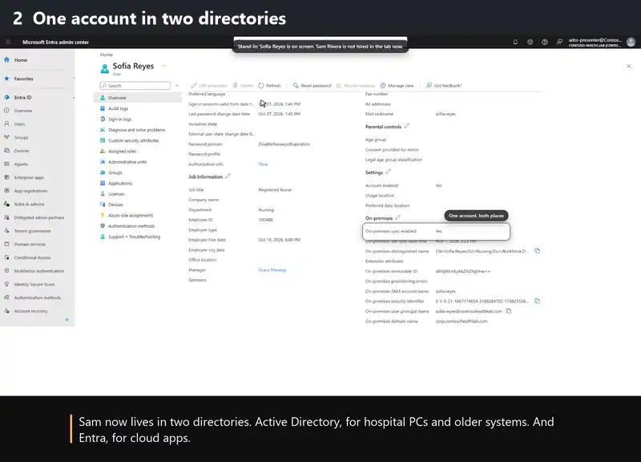
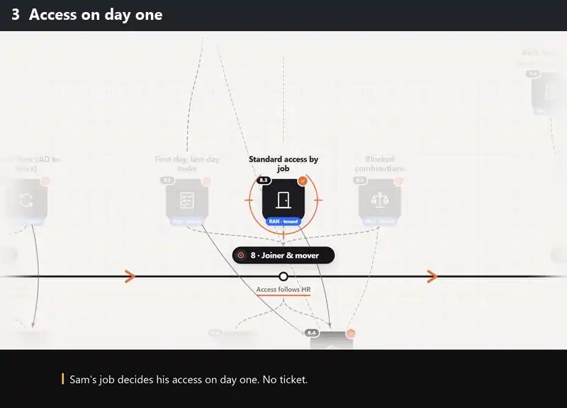
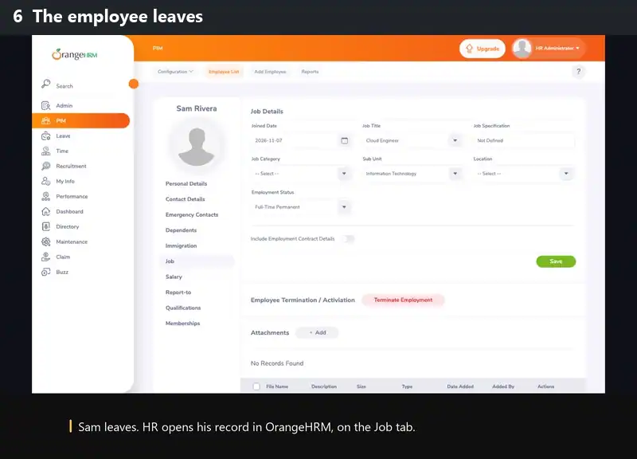
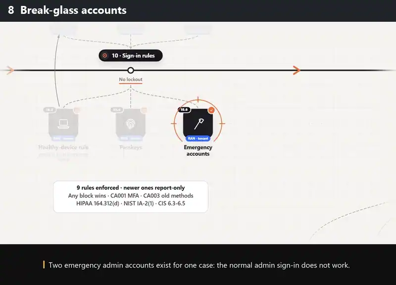
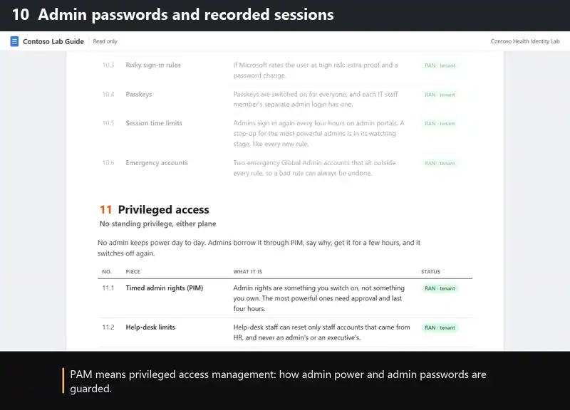
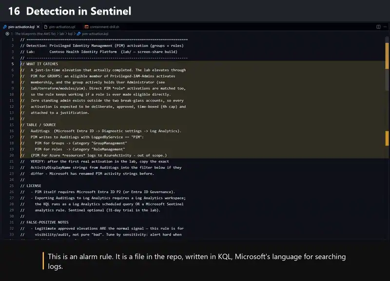
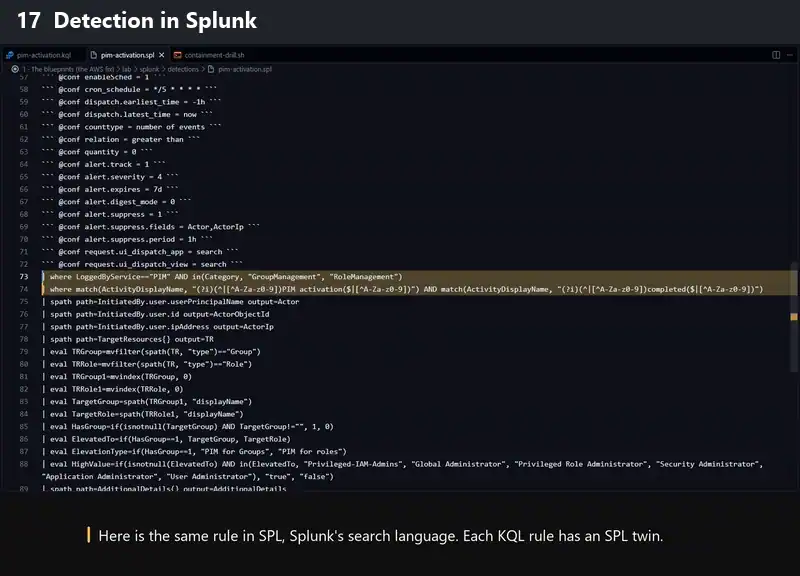
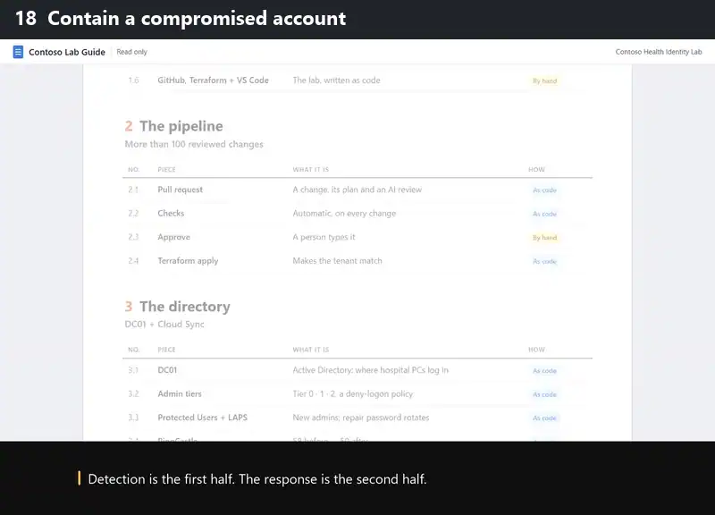
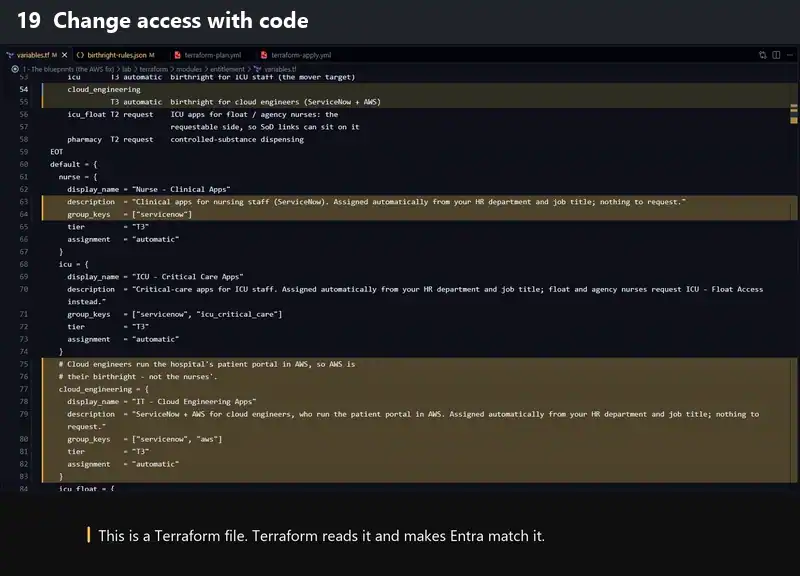
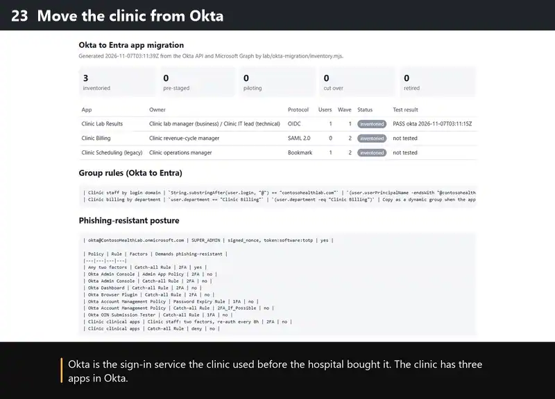

# Contoso Health Identity Lab

**IAM and PAM lab · Microsoft Entra ID · identity as code**

Michael Williams · Microsoft SC-300 · CyberArk Guardian, Sentry, Defender

I built an identity platform for a fictional hospital with 5,000 employees. It runs in a real
Microsoft Entra tenant, and all of it is code. The clips follow one new employee, Sam Rivera, from
hire to departure. **In the first measured leaver run, for nurse Dana Okafor, Active Directory
disabled the account in 7 seconds and Entra in less than 3 minutes.**

The 23 chapters below show the lab in operation. Each loop is a silent clip at a higher speed.

| Part | Chapter | Summary |
|---|---|---|
| Identity lifecycle | [1. HR hires an employee](#1-hr-hires-an-employee) | HR adds Sam. No person sets a password. |
| Identity lifecycle | [2. One account in two directories](#2-one-account-in-two-directories) | Active Directory gets the account first, then Entra ID. |
| Identity lifecycle | [3. Access on day one](#3-access-on-day-one) | Sam gets access from his job title. |
| Identity lifecycle | [4. Request more access](#4-request-more-access) | A nurse asks, her manager approves, Entra gives the access. |
| Identity lifecycle | [5. The employee changes jobs](#5-the-employee-changes-jobs) | HR moves a nurse to a new department. The access follows. |
| Identity lifecycle | [6. The employee leaves](#6-the-employee-leaves) | Four systems disable the account with no ticket. |
| Sign-in security | [7. Conditional Access and MFA](#7-conditional-access-and-mfa) | Eleven sign-in policies as code. Nine are enforced. |
| Sign-in security | [8. Break-glass accounts](#8-break-glass-accounts) | Two emergency accounts, out of all policies, with an alarm. |
| Privileged access | [9. Temporary admin rights](#9-temporary-admin-rights) | An admin activates a role for a limited time. |
| Privileged access | [10. Admin passwords and recorded sessions](#10-admin-passwords-and-recorded-sessions) | Secrets in a vault, sessions on record. |
| Privileged access | [11. Harden Active Directory](#11-harden-active-directory) | Admin tiers on the domain controller. |
| Privileged access | [12. Admin access in AWS and Azure](#12-admin-access-in-aws-and-azure) | Temporary server access and a narrow role. |
| Governance and audit | [13. Access governance](#13-access-governance) | Reviews, expiry, and blocked combinations. |
| Governance and audit | [14. Service accounts and robots](#14-service-accounts-and-robots) | An inventory of 19 non-human identities, with findings. |
| Governance and audit | [15. Audit evidence](#15-audit-evidence) | Seven records go to a write-once store. |
| Detect and respond | [16. Detection in Sentinel](#16-detection-in-sentinel) | A rule in code opens an incident. |
| Detect and respond | [17. Detection in Splunk](#17-detection-in-splunk) | The same rules run in a second SIEM. |
| Detect and respond | [18. Contain a compromised account](#18-contain-a-compromised-account) | A person approves in Teams. A playbook disables the account. |
| Platform as code | [19. Change access with code](#19-change-access-with-code) | A Terraform change goes from commit to pull request to plan. |
| Platform as code | [20. Checks on the code](#20-checks-on-the-code) | Scanners that must fail on a bad file. |
| Platform as code | [21. The lab in VS Code and GitHub](#21-the-lab-in-vs-code-and-github) | The code, the pipeline, and the approval. |
| Migrations | [22. Move an app from AD FS](#22-move-an-app-from-ad-fs) | One app moves to Entra. |
| Migrations | [23. Move the clinic from Okta](#23-move-the-clinic-from-okta) | Three Okta apps and their move to Entra. |

Design decisions and risks: [36 decision records](lab/docs/adr/README.md) · [threat model](lab/docs/threat-model.md) · [risk register](lab/docs/risk-register.md) · [field notes](lab/docs/field-notes.md)

## Identity lifecycle

### 1. HR hires an employee

**HR adds Sam Rivera in OrangeHRM. The form has no password field, and no ticket goes to IT.**

[Full clip, 1:53](demo/videos/N02-hired.mp4)

### 2. One account in two directories

**The new account goes to Active Directory first. Cloud Sync then makes the same account in Entra ID.**

[Full clip, 0:27](demo/videos/N03-one-account-two-directories.mp4)

### 3. Access on day one

**Sam gets access from his job title: an access package, AWS sign-in through Entra, and read-only access to the patient portal.**

[Full clip, 1:52](demo/videos/N04-first-day-doors.mp4)

### 4. Request more access

**A nurse asks for ICU apps in ServiceNow. Her manager approves, and Entra gives the access.**

[Full clip, 2:28](demo/videos/N04b-the-service-desk.mp4)

### 5. The employee changes jobs

**HR moves a nurse from Nursing to ICU. The account gets the ICU access package from the new department.**

[Full clip, 0:44](demo/videos/N20-the-employee-changes-jobs.mp4)

### 6. The employee leaves

**HR ends Sam's job. Active Directory, Entra, ServiceNow, and AWS each disable the account, with no ticket.**

[Full clip, 1:05](demo/videos/N08-leaving.mp4)

## Sign-in security

### 7. Conditional Access and MFA

**Eleven sign-in policies are code. Each policy starts in report-only mode, and nine are enforced.**

[Full clip, 0:57](demo/videos/N18-conditional-access.mp4)

### 8. Break-glass accounts

**Two emergency admin accounts are out of all 11 policies. A drill examines them, and a Sentinel rule reports each sign-in.**

[Full clip, 0:56](demo/videos/N19-break-glass.mp4)

## Privileged access

### 9. Temporary admin rights

**An admin has no standing rights. He activates the help-desk role in PIM for a limited time, with a reason.**

[Full clip, 1:15](demo/videos/N05-the-master-key.mp4)

### 10. Admin passwords and recorded sessions

**Key Vault holds the admin secrets, Terraform reads a secret and keeps no copy, and Azure Bastion records the admin session.**

[Full clip, 2:17](demo/videos/N11-admin-passwords-and-sessions.mp4)

### 11. Harden Active Directory

**Admin tiers on the domain controller keep top admins off lower-tier computers. A scan shows the state before and after.**

[Full clip, 1:34](demo/videos/N12-hardening-ad.mp4)

### 12. Admin access in AWS and Azure

**A server shell in AWS opens only through Session Manager, during a temporary admin window. Azure uses a narrow operator role.**

[Full clip, 1:06](demo/videos/N15-aws-server-access-and-azure-least-privilege.mp4)

## Governance and audit

### 13. Access governance

**Access reviews, access that expires, and blocked combinations of access, each configured as code.**

[Full clip, 1:49](demo/videos/N10-microsoft-features.mp4)

### 14. Service accounts and robots

**An inventory lists 19 non-human identities and gives 27 findings. Eight identities have no owner.**

[Full clip, 0:49](demo/videos/N21-service-accounts.mp4)

### 15. Audit evidence

**One click files seven evidence records in a write-once store. Each record has a SHA-256 hash.**

[Full clip, 1:18](demo/videos/N09-the-logbook.mp4)

## Detect and respond

### 16. Detection in Sentinel

**A detection rule, written as code, finds an admin activation and opens an incident in Microsoft Sentinel.**

[Full clip, 1:03](demo/videos/N06-the-cameras.mp4)

### 17. Detection in Splunk

**The same rules, in the Splunk search language, run on the same tenant logs.**

[Full clip, 0:42](demo/videos/N07-the-second-camera.mp4)

### 18. Contain a compromised account

**A Sentinel incident asks a named approver in Teams. After the approval, a playbook revokes the sessions and disables the account.**

[Full clip, 1:06](demo/videos/N22-contain-an-account.mp4)

## Platform as code

### 19. Change access with code

**A Terraform change moves AWS access from nurses to cloud engineers, from commit to pull request to plan.**

[Full clip, 2:22](demo/videos/N01-the-blueprints.mp4)

### 20. Checks on the code

**A Kubernetes permission check, and scanners that must fail on an unsafe file before the pipeline trusts them.**

[Full clip, 0:50](demo/videos/N16-code-checks.mp4)

### 21. The lab in VS Code and GitHub

**The code in VS Code, the GitHub Actions runs, the pull requests, and the approval before each apply.**

[Full clip, 0:56](demo/videos/N17-close-vscode-github.mp4)

## Migrations

### 22. Move an app from AD FS

**One app moves from AD FS, an older sign-in server, to Entra. The build and the tests are complete. The cut-over did not run.**

[Full clip, 1:25](demo/videos/N13-adfs-to-entra.mp4)

### 23. Move the clinic from Okta

**The hospital bought a clinic with three apps in Okta. A tracker from live reads shows their move to Entra.**

[Full clip, 1:21](demo/videos/N14-okta.mp4)

---

Results, limits, and evidence: [`lab/docs/platform-details.md`](lab/docs/platform-details.md).
How the clips are made: [`demo/README.md`](demo/README.md).
