# Contoso Health Identity Lab

**IAM and PAM lab · Microsoft Entra ID · identity as code**

I built an identity platform for a fictional hospital with 5,000 employees. It runs in a real
Microsoft Entra tenant, and all of it is code. The clips follow one new employee, Sam Rivera, from
hire to departure. **In the first measured leaver run, for nurse Dana Okafor, Active Directory
disabled the account in 7 seconds and Entra in less than 3 minutes.**

The 18 chapters below show the lab in operation. Each loop is a silent clip at a higher speed.

| Chapter | Summary |
|---|---|
| [1. Change access with code](#1-change-access-with-code) | A Terraform change goes from commit to pull request to plan. |
| [2. HR hires an employee](#2-hr-hires-an-employee) | HR adds Sam. No person sets a password. |
| [3. One account in two directories](#3-one-account-in-two-directories) | Active Directory gets the account first, then Entra ID. |
| [4. Access on day one](#4-access-on-day-one) | Sam gets access from his job title. |
| [5. Request more access](#5-request-more-access) | A nurse asks, her manager approves, Entra gives the access. |
| [6. Temporary admin rights](#6-temporary-admin-rights) | An admin activates a role for a limited time. |
| [7. Detection in Sentinel](#7-detection-in-sentinel) | A rule in code opens an incident. |
| [8. Detection in Splunk](#8-detection-in-splunk) | The same rules run in a second SIEM. |
| [9. The employee leaves](#9-the-employee-leaves) | Four systems disable the account with no ticket. |
| [10. Audit evidence](#10-audit-evidence) | Seven records go to a write-once store. |
| [11. Access governance](#11-access-governance) | Reviews, expiry, and blocked combinations. |
| [12. Admin passwords and recorded sessions](#12-admin-passwords-and-recorded-sessions) | Secrets in a vault, sessions on record. |
| [13. Harden Active Directory](#13-harden-active-directory) | Admin tiers on the domain controller. |
| [14. Move an app from AD FS](#14-move-an-app-from-ad-fs) | One app moves to Entra. |
| [15. Move the clinic from Okta](#15-move-the-clinic-from-okta) | Three Okta apps and their move to Entra. |
| [16. Admin access in AWS and Azure](#16-admin-access-in-aws-and-azure) | Temporary server access and a narrow role. |
| [17. Checks on the code](#17-checks-on-the-code) | Scanners that must fail on a bad file. |
| [18. The lab in VS Code and GitHub](#18-the-lab-in-vs-code-and-github) | The code, the pipeline, and the approval. |

## 1. Change access with code

**A Terraform change moves AWS access from nurses to cloud engineers, from commit to pull request to plan.**

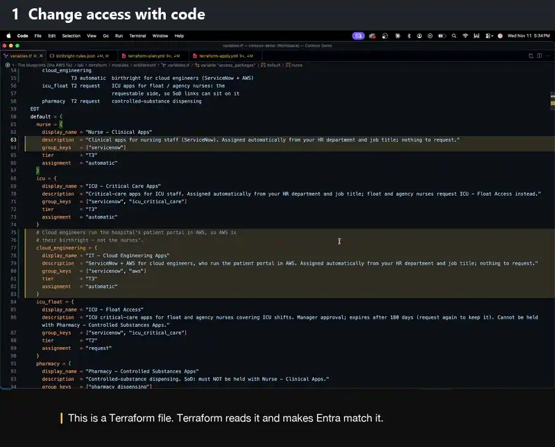

[Full clip, 3:27](demo/videos/N01-the-blueprints.mp4)

## 2. HR hires an employee

**HR adds Sam Rivera in OrangeHRM. The form has no password field, and no ticket goes to IT.**

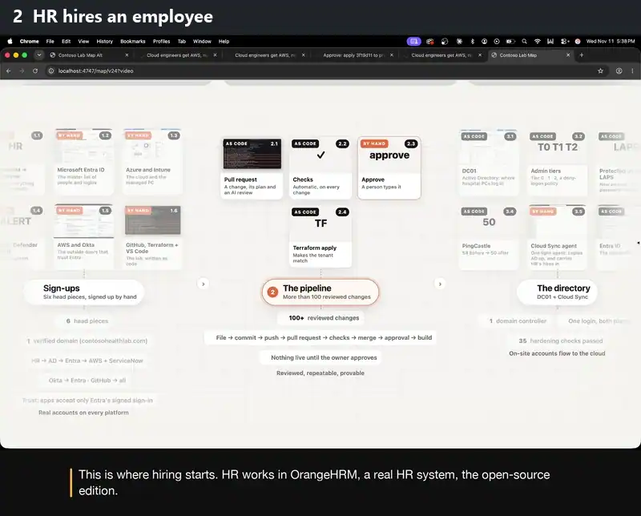

[Full clip, 2:03](demo/videos/N02-hired.mp4)

## 3. One account in two directories

**The new account goes to Active Directory first. Cloud Sync then makes the same account in Entra ID.**

The clip for this chapter needs a live sign-in. It comes later.

## 4. Access on day one

**Sam gets access from his job title: an access package, AWS sign-in through Entra, and read-only access to the patient portal.**

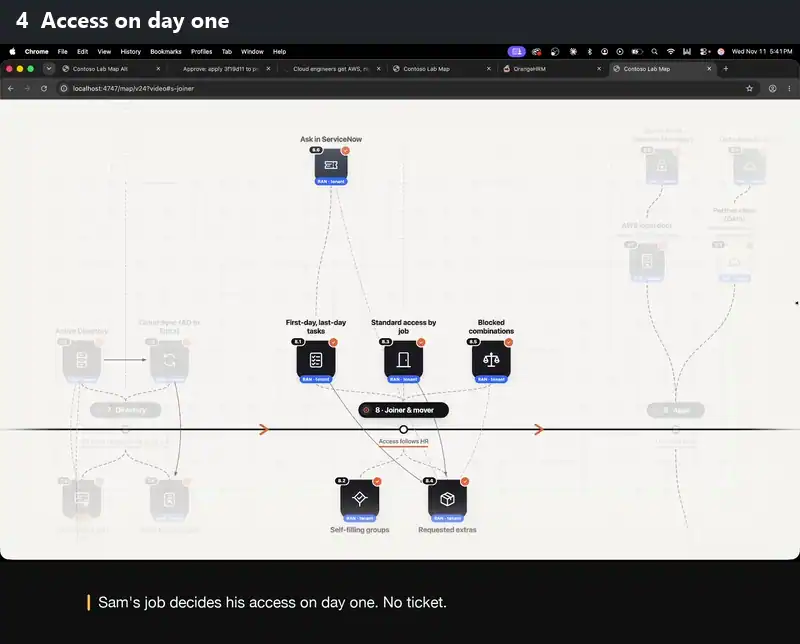

[Full clip, 1:40](demo/videos/N04-first-day-doors.mp4)

## 5. Request more access

**A nurse asks for ICU apps in ServiceNow. Her manager approves, and Entra gives the access.**

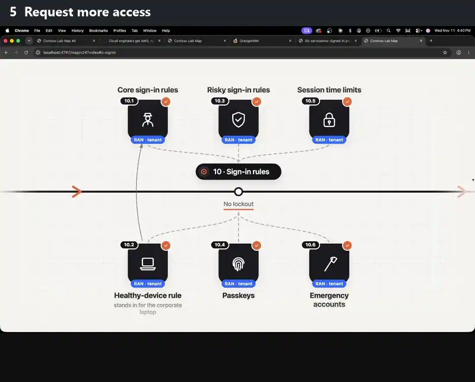

[Full clip, 3:12](demo/videos/N04b-the-service-desk.mp4)

## 6. Temporary admin rights

**An admin has no standing rights. He activates the help-desk role in PIM for a limited time, with a reason.**

The clip for this chapter needs a live sign-in. It comes later.

## 7. Detection in Sentinel

**A detection rule, written as code, finds an admin activation and opens an incident in Microsoft Sentinel.**

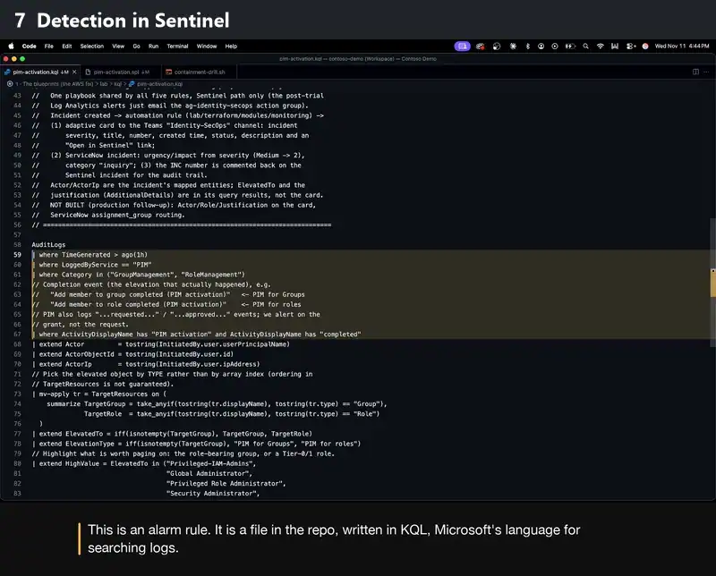

[Full clip, 3:15](demo/videos/N06-the-cameras.mp4)

## 8. Detection in Splunk

**The same rules, in the Splunk search language, run on the same tenant logs.**

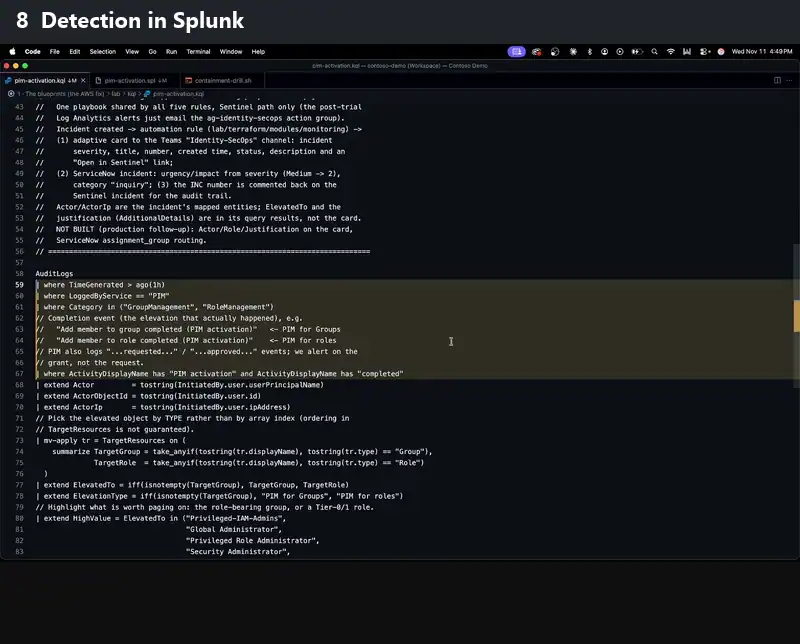

[Full clip, 1:12](demo/videos/N07-the-second-camera.mp4)

## 9. The employee leaves

**HR ends Sam's job. Active Directory, Entra, ServiceNow, and AWS each disable the account, with no ticket.**

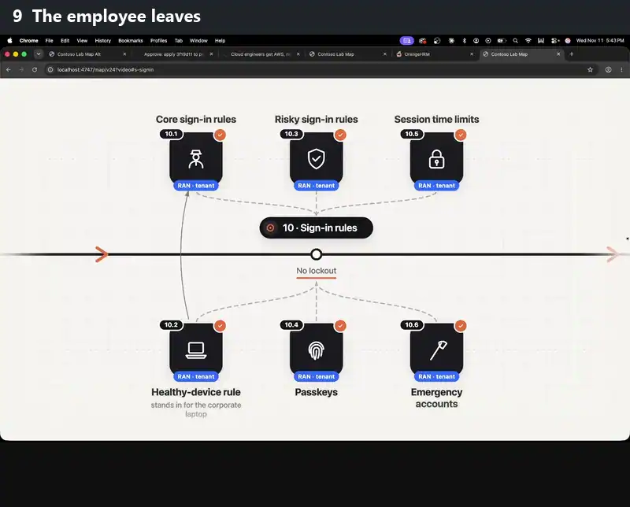

[Full clip, 0:56](demo/videos/N08-leaving.mp4)

## 10. Audit evidence

**One click files seven evidence records in a write-once store. Each record has a SHA-256 hash.**

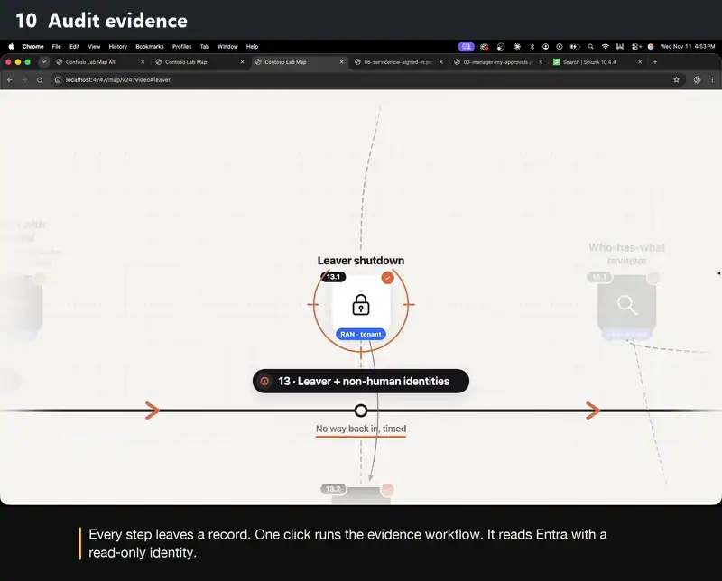

[Full clip, 1:59](demo/videos/N09-the-logbook.mp4)

## 11. Access governance

**Access reviews, access that expires, and blocked combinations of access, each configured as code.**

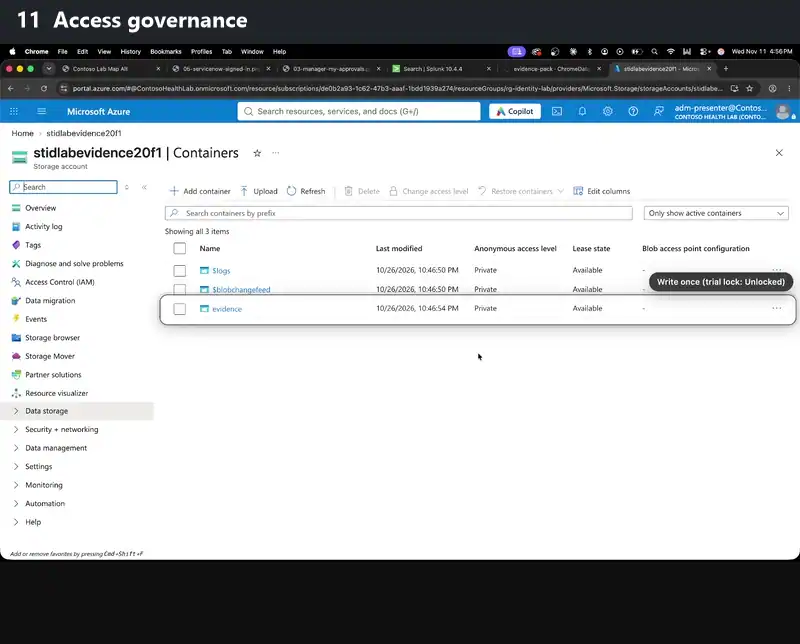

[Full clip, 2:57](demo/videos/N10-microsoft-features.mp4)

## 12. Admin passwords and recorded sessions

**Key Vault holds the admin secrets, Terraform reads a secret and keeps no copy, and Azure Bastion records the admin session.**

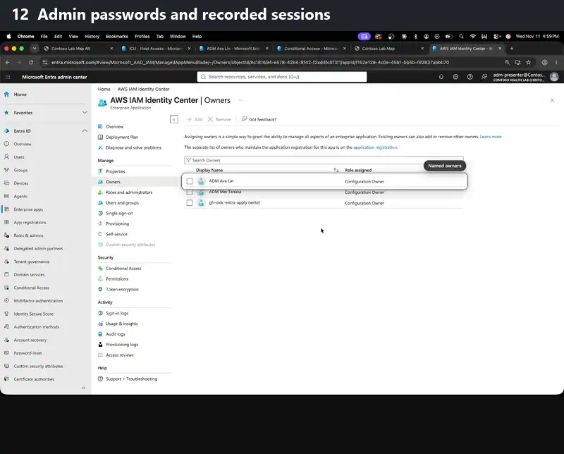

[Full clip, 3:14](demo/videos/N11-admin-passwords-and-sessions.mp4)

## 13. Harden Active Directory

**Admin tiers on the domain controller keep top admins off lower-tier computers. A scan shows the state before and after.**

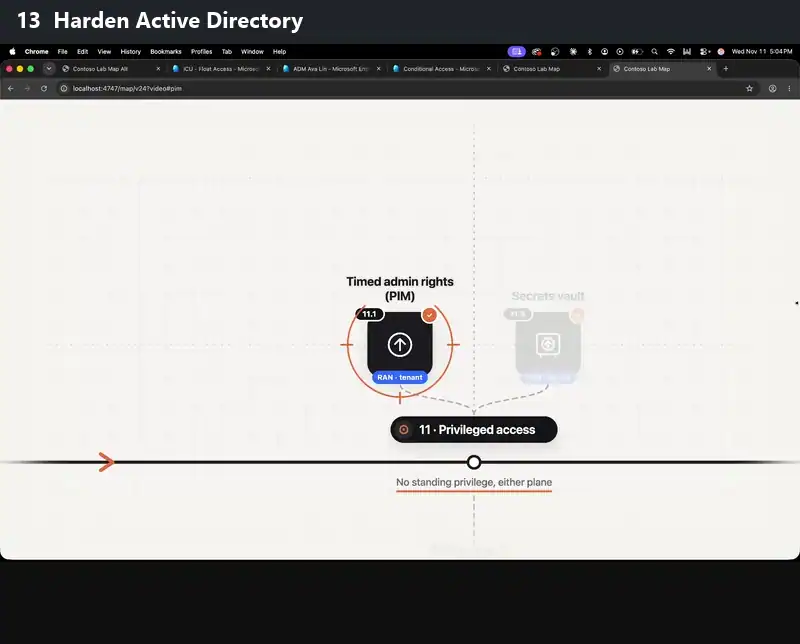

[Full clip, 1:55](demo/videos/N12-hardening-ad.mp4)

## 14. Move an app from AD FS

**One app moves from AD FS, an older sign-in server, to Entra. The build and the tests are complete. The cut-over did not run.**

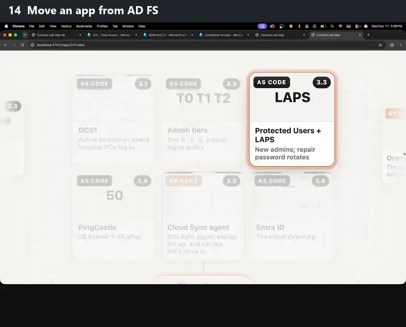

[Full clip, 1:33](demo/videos/N13-adfs-to-entra.mp4)

## 15. Move the clinic from Okta

**The hospital bought a clinic with three apps in Okta. A tracker from live reads shows their move to Entra.**

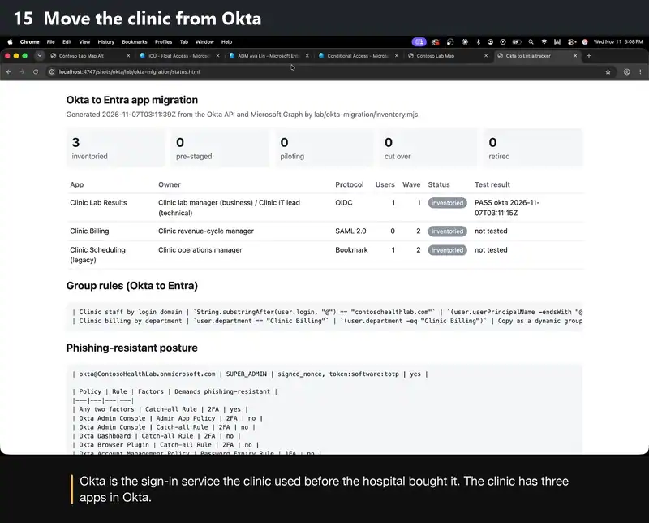

[Full clip, 1:48](demo/videos/N14-okta.mp4)

## 16. Admin access in AWS and Azure

**A server shell in AWS opens only through Session Manager, during a temporary admin window. Azure uses a narrow operator role.**

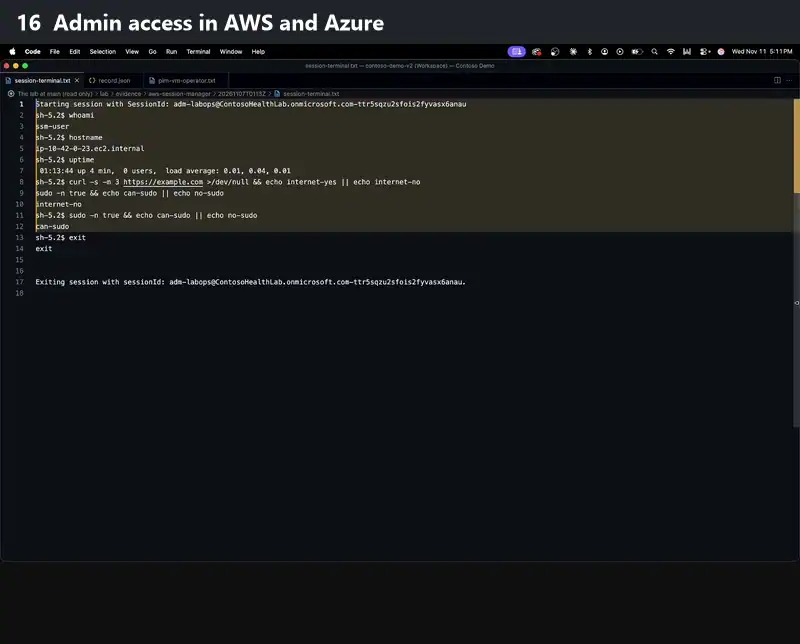

[Full clip, 1:35](demo/videos/N15-aws-server-access-and-azure-least-privilege.mp4)

## 17. Checks on the code

**A Kubernetes permission check, and scanners that must fail on an unsafe file before the pipeline trusts them.**

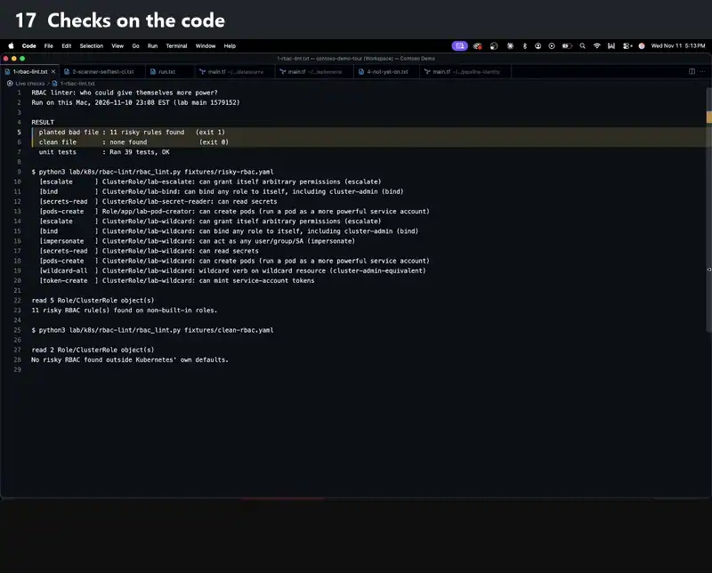

[Full clip, 1:29](demo/videos/N16-code-checks.mp4)

## 18. The lab in VS Code and GitHub

**The code in VS Code, the GitHub Actions runs, the pull requests, and the approval before each apply.**

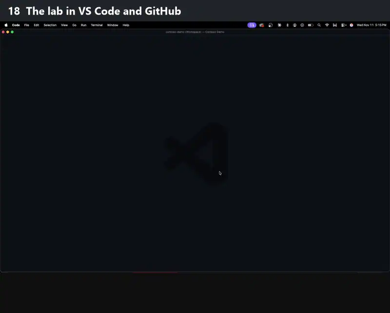

[Full clip, 1:18](demo/videos/N17-close-vscode-github.mp4)

---

Results, limits, and evidence: [`lab/docs/platform-details.md`](lab/docs/platform-details.md).
How the clips were made: [`demo/README.md`](demo/README.md).
