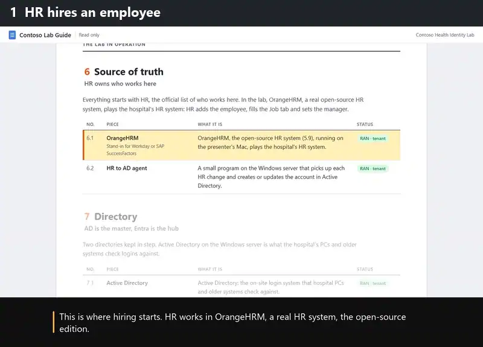

# 1. HR hires an employee

Identity lifecycle · [Contoso Health Identity Lab](../../README.md)

**HR adds Sam Rivera in OrangeHRM. The form has no password field, and no ticket goes to IT.**

[Full clip, 1:52](../videos/N02-hired.mp4)

## Where it lives

| | |
|---|---|
| **Code** | [The HR system and its connector](../../lab/hris/README.md) · [The connector](../../lab/hris/connector/sync.mjs) · [The inbound provisioning app](../../lab/scripts/mock-hr/New-InboundProvisioningApp.ps1) |
| **Test** | [Connector tests](../../lab/hris/connector/tests) |
| **Evidence** | [Capture log, row E91](../../lab/evidence/capture-log.csv) |
| **Decision** | [ADR 0028: OrangeHRM as the HR system](../../lab/docs/adr/0028-orangehrm-as-the-hris.md) · [ADR 0006: API-driven inbound provisioning](../../lab/docs/adr/0006-api-driven-inbound-provisioning-vs-workday-connector.md) |

---

[All chapters](../../README.md) · [2. One account in two directories →](02-one-account-in-two-directories.md)
