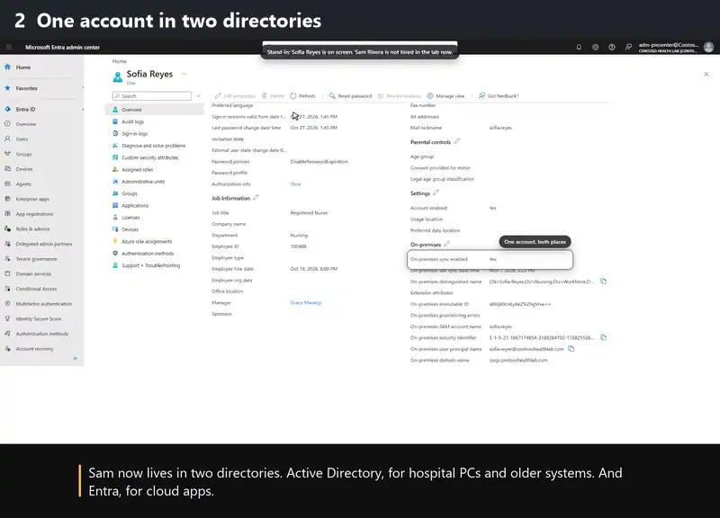

# 2. One account in two directories

Identity lifecycle · [Contoso Health Identity Lab](../../README.md)

**The new account goes to Active Directory first. Cloud Sync then makes the same account in Entra ID.**

[Full clip, 0:28](../videos/N03-one-account-two-directories.mp4)

## Where it lives

| | |
|---|---|
| **Code** | [Cloud Sync agent install](../../lab/scripts/dc/04-Install-CloudSyncAgent.ps1) · [Sync configuration](../../lab/scripts/dc/configure-sync.py) · [The domain controller scripts](../../lab/scripts/dc/README.md) |
| **Test** | [Domain controller script tests](../../lab/scripts/dc/tests) |
| **Evidence** | [Capture log, row E52](../../lab/evidence/capture-log.csv) |
| **Decision** | [ADR 0001: Cloud Sync, not Connect Sync](../../lab/docs/adr/0001-cloud-sync-vs-connect-sync.md) |

---

[← 1. HR hires an employee](01-hr-hires-an-employee.md) · [All chapters](../../README.md) · [3. Access on day one →](03-access-on-day-one.md)
