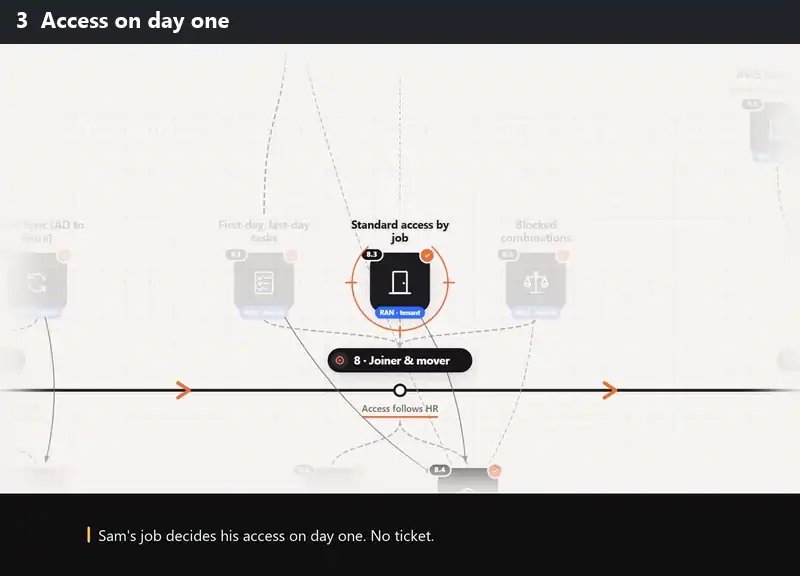

# 3. Access on day one

Identity lifecycle · [Contoso Health Identity Lab](../../README.md)

**Sam gets access from his job title: an access package, AWS sign-in through Entra, and read-only access to the patient portal.**

[Full clip, 1:51](../videos/N04-first-day-doors.mp4)

## Where it lives

| | |
|---|---|
| **Code** | [Access packages (Terraform)](../../lab/terraform/modules/entitlement/README.md) · [Birthright rules](../../lab/iga/birthright-rules.json) · [Sign-on and provisioning for the apps](../../lab/terraform/modules/apps/README.md) |
| **Test** | [Entitlement tests](../../lab/terraform/modules/entitlement/tests) · [Apps tests](../../lab/terraform/modules/apps/tests) |
| **Evidence** | [Capture log, rows E19, E22, E23](../../lab/evidence/capture-log.csv) |
| **Decision** | [ADR 0008: Entra ID Governance for access](../../lab/docs/adr/0008-iga-entra-id-governance-midpoint-vs-sailpoint-saviynt.md) |

---

[← 2. One account in two directories](02-one-account-in-two-directories.md) · [All chapters](../../README.md) · [4. Request more access →](04-request-more-access.md)
