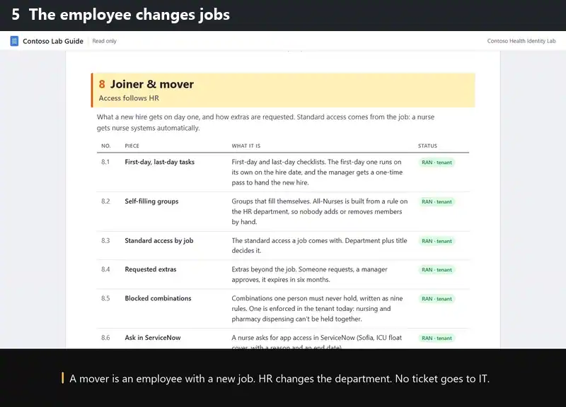

# 5. The employee changes jobs

Identity lifecycle · [Contoso Health Identity Lab](../../README.md)

**HR moves a nurse from Nursing to ICU. The account gets the ICU access package from the new department.**

[Full clip, 0:45](../videos/N20-the-employee-changes-jobs.mp4)

## Where it lives

| | |
|---|---|
| **Code** | [The mover script](../../lab/scripts/powershell/03-Mover.ps1) · [Birthright rules](../../lab/iga/birthright-rules.json) |
| **Test** | [Mover tests](../../lab/scripts/powershell/tests/03-Mover.Tests.ps1) |
| **Evidence** | [Capture log, row E52](../../lab/evidence/capture-log.csv) |
| **Decision** | [ADR 0006: API-driven inbound provisioning](../../lab/docs/adr/0006-api-driven-inbound-provisioning-vs-workday-connector.md) |

---

[← 4. Request more access](04-request-more-access.md) · [All chapters](../../README.md) · [6. The employee leaves →](06-the-employee-leaves.md)
