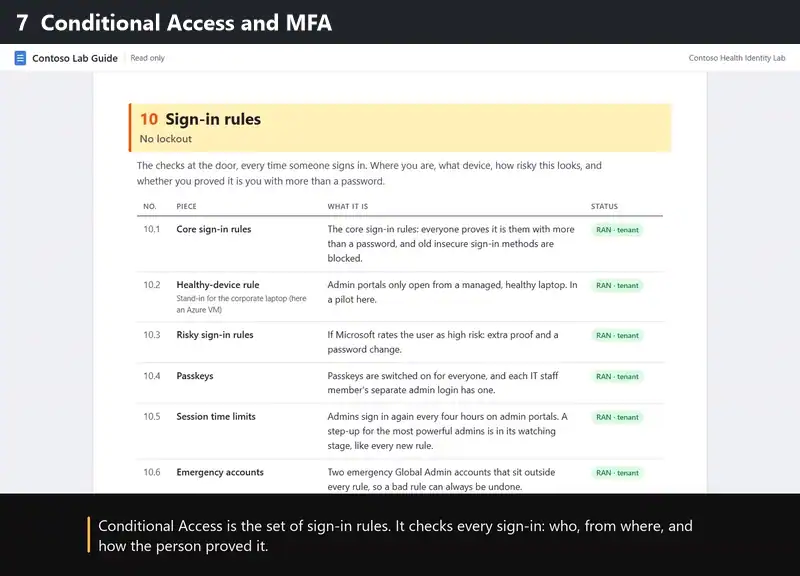

# 7. Conditional Access and MFA

Sign-in security · [Contoso Health Identity Lab](../../README.md)

**Eleven sign-in policies are code. Each policy starts in report-only mode, and nine are enforced.**

[Full clip, 0:58](../videos/N18-conditional-access.mp4)

## Where it lives

| | |
|---|---|
| **Code** | [The Conditional Access module](../../lab/terraform/modules/conditional-access/README.md) · [The staging flags of the lab](../../lab/terraform/envs/dev/lab.tfvars) |
| **Test** | [Policy tests](../../lab/terraform/modules/conditional-access/tests) |
| **Evidence** | [Capture log, rows E12, E30](../../lab/evidence/capture-log.csv) |
| **Decision** | [ADR 0003: exclusions and break-glass](../../lab/docs/adr/0003-ca-exclusions-and-break-glass.md) · [ADR 0015: risk thresholds](../../lab/docs/adr/0015-risk-based-conditional-access-thresholds.md) · [Design principles](../../lab/docs/standards/conditional-access-design-principles.md) |
| **Runbook** | [Graduate a policy](../../lab/docs/runbooks/graduate-a-ca-policy.md) |

---

[← 6. The employee leaves](06-the-employee-leaves.md) · [All chapters](../../README.md) · [8. Break-glass accounts →](08-break-glass-accounts.md)
