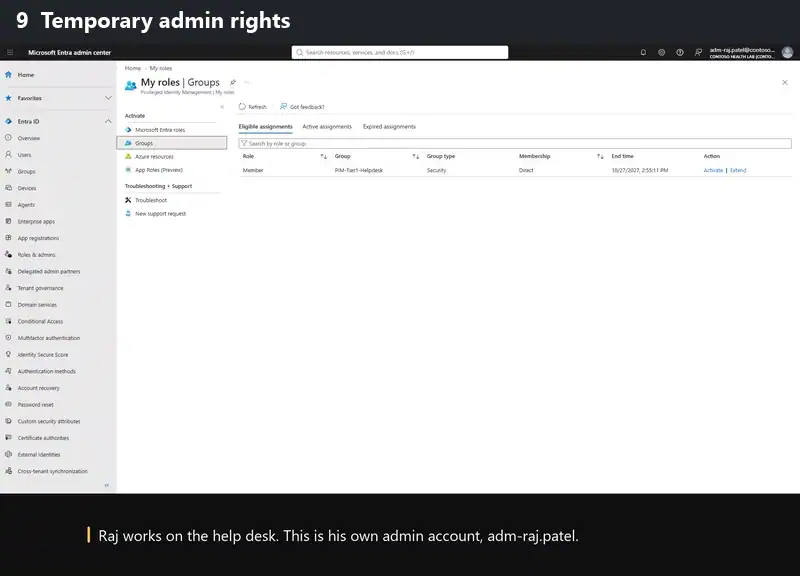

# 9. Temporary admin rights

Privileged access · [Contoso Health Identity Lab](../../README.md)

**An admin has no standing rights. He activates the help-desk role in PIM for a limited time, with a reason.**

[Full clip, 1:16](../videos/N05-the-master-key.mp4)

## Where it lives

| | |
|---|---|
| **Code** | [The PIM module](../../lab/terraform/modules/pim/README.md) |
| **Test** | [PIM tests](../../lab/terraform/modules/pim/tests) |
| **Evidence** | [Capture log, row E16](../../lab/evidence/capture-log.csv) |
| **Decision** | [ADR 0002: PIM for Groups](../../lab/docs/adr/0002-pim-for-groups-vs-direct-role-eligibility.md) · [ADR 0020: activation design](../../lab/docs/adr/0020-pim-activation-design.md) |
| **Runbook** | [PIM activation support](../../lab/docs/runbooks/pim-activation-support.md) |

---

[← 8. Break-glass accounts](08-break-glass-accounts.md) · [All chapters](../../README.md) · [10. Admin passwords and recorded sessions →](10-admin-passwords-and-recorded-sessions.md)
