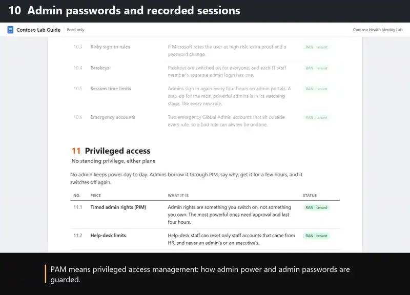

# 10. Admin passwords and recorded sessions

Privileged access · [Contoso Health Identity Lab](../../README.md)

**Key Vault holds the admin secrets, Terraform reads a secret and keeps no copy, and Azure Bastion records the admin session.**

[Full clip, 2:18](../videos/N11-admin-passwords-and-sessions.mp4)

## Where it lives

| | |
|---|---|
| **Code** | [The Key Vault module](../../lab/terraform/modules/keyvault/README.md) · [The state leak test](../../lab/secrets/state-leak/README.md) · [Recorded sessions with Bastion](../../lab/bastion/README.md) |
| **Test** | [Key Vault tests](../../lab/terraform/modules/keyvault/tests) · [State leak tests](../../lab/secrets/state-leak/tests) |
| **Evidence** | [The state leak run](../../lab/evidence/keyvault-state-leak/20261107T014803Z) · [The Bastion recording run](../../lab/evidence/bastion-session-recording/20261107T021051Z) · [Capture log, row E186](../../lab/evidence/capture-log.csv) |
| **Decision** | [ADR 0036: Microsoft products for PAM](../../lab/docs/adr/0036-microsoft-native-pam.md) |

---

[← 9. Temporary admin rights](09-temporary-admin-rights.md) · [All chapters](../../README.md) · [11. Harden Active Directory →](11-harden-active-directory.md)
