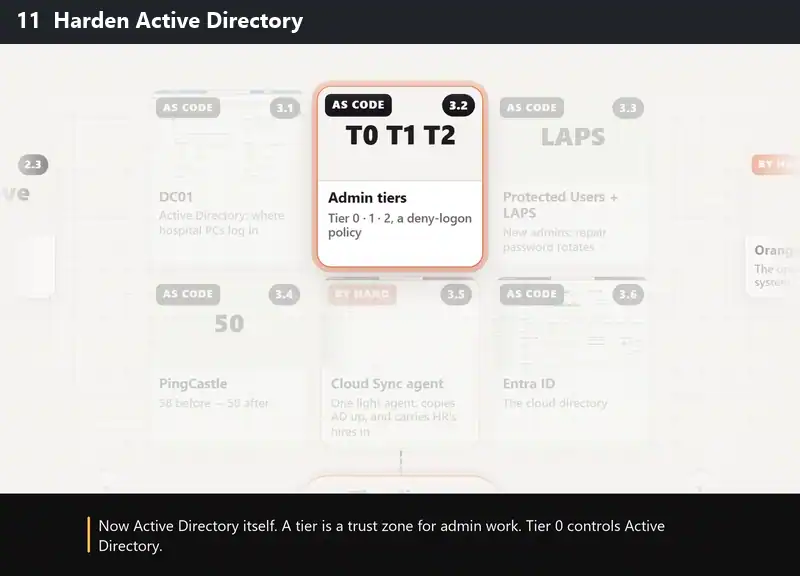

# 11. Harden Active Directory

Privileged access · [Contoso Health Identity Lab](../../README.md)

**Admin tiers on the domain controller keep top admins off lower-tier computers. A scan shows the state before and after.**

[Full clip, 1:34](../videos/N12-hardening-ad.mp4)

## Where it lives

| | |
|---|---|
| **Code** | [The hardening scripts](../../lab/scripts/dc/hardening/README.md) · [Admin tiers](../../lab/scripts/dc/hardening/Set-AdTiering.ps1) · [Windows LAPS](../../lab/scripts/dc/hardening/Enable-WindowsLaps.ps1) |
| **Test** | [The verify script](../../lab/scripts/dc/hardening/Test-AdHardening.ps1) · [Domain controller script tests](../../lab/scripts/dc/tests) |
| **Evidence** | [The hardening run, before and after](../../lab/evidence/ad-hardening/20261107T0057Z) |
| **Decision** | [ADR 0013: exposure of the domain controller](../../lab/docs/adr/0013-tier0-domain-controller-exposure.md) · [Privileged access standard](../../lab/docs/standards/privileged-access-standard.md) |

---

[← 10. Admin passwords and recorded sessions](10-admin-passwords-and-recorded-sessions.md) · [All chapters](../../README.md) · [12. Admin access in AWS and Azure →](12-admin-access-in-aws-and-azure.md)
