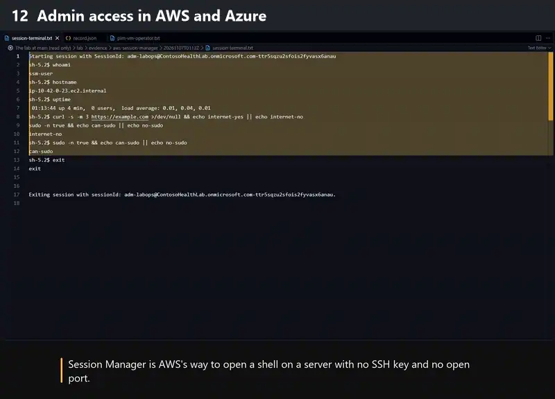

# 12. Admin access in AWS and Azure

Privileged access · [Contoso Health Identity Lab](../../README.md)

**A server shell in AWS opens only through Session Manager, during a temporary admin window. Azure uses a narrow operator role.**

[Full clip, 1:07](../videos/N15-aws-server-access-and-azure-least-privilege.mp4)

---

[← 11. Harden Active Directory](11-harden-active-directory.md) · [All chapters](../../README.md) · [13. Access governance →](13-access-governance.md)
