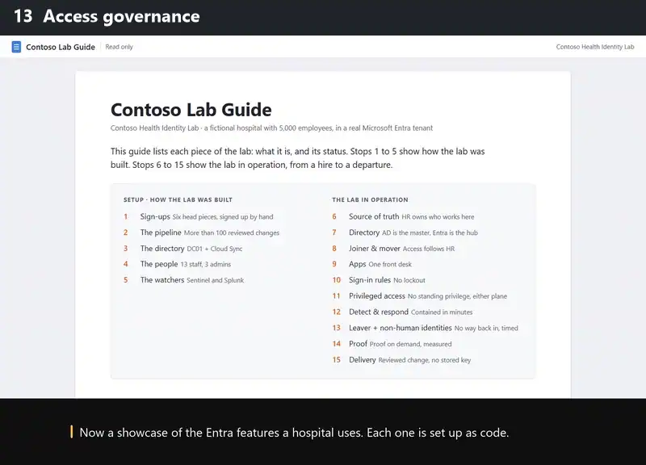

# 13. Access governance

Governance and audit · [Contoso Health Identity Lab](../../README.md)

**Access reviews, access that expires, and blocked combinations of access, each configured as code.**

[Full clip, 1:49](../videos/N10-microsoft-features.mp4)

---

[← 12. Admin access in AWS and Azure](12-admin-access-in-aws-and-azure.md) · [All chapters](../../README.md) · [14. Service accounts and robots →](14-service-accounts-and-robots.md)
