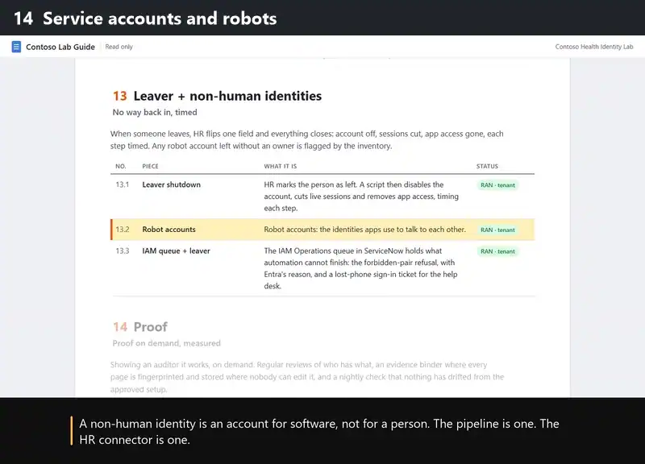

# 14. Service accounts and robots

Governance and audit · [Contoso Health Identity Lab](../../README.md)

**The first inventory found 19 non-human identities and 27 findings. Eight had no owner then. Each one has an owner now.**

[Full clip, 0:52](../videos/N21-service-accounts.mp4)

## Where it lives

| | |
|---|---|
| **Code** | [The inventory script](../../lab/scripts/powershell/06-NHI-Inventory.ps1) · [The owner list](../../lab/iga/nhi-owners.json) |
| **Test** | [Inventory tests](../../lab/scripts/powershell/tests/06-NHI-Inventory.Tests.ps1) |
| **Evidence** | [The inventory run](../../lab/evidence/nhi/20261105T101425Z) · [Capture log, rows E21, E70](../../lab/evidence/capture-log.csv) |
| **Decision** | [ADR 0018: owners of non-human identities](../../lab/docs/adr/0018-nhi-ownership-and-agent-identity-sponsorship.md) · [Non-human identity standard](../../lab/docs/standards/nhi-standard.md) |

---

[← 13. Access governance](13-access-governance.md) · [All chapters](../../README.md) · [15. Audit evidence →](15-audit-evidence.md)
