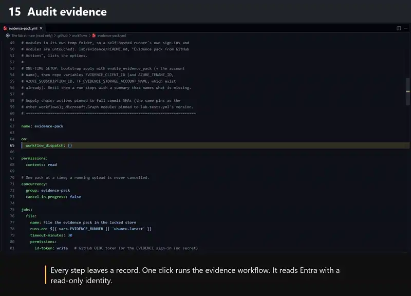

# 15. Audit evidence

Governance and audit · [Contoso Health Identity Lab](../../README.md)

**One click files seven evidence records in a write-once store. Each record has a SHA-256 hash.**

[Full clip, 1:18](../videos/N09-the-logbook.mp4)

## Where it lives

| | |
|---|---|
| **Code** | [The evidence workflow](../../.github/workflows/evidence-pack.yml) · [The export script](../../lab/scripts/powershell/Export-EvidencePack.ps1) · [The write-once store (Terraform)](../../lab/terraform/modules/evidence-store/README.md) |
| **Test** | [Export tests](../../lab/scripts/powershell/tests/Export-EvidencePack.Tests.ps1) · [Store tests](../../lab/terraform/modules/evidence-store/tests) |
| **Evidence** | [How the evidence folder works](../../lab/evidence/README.md) · [Capture log, rows E06, E56, E74](../../lab/evidence/capture-log.csv) |

---

[← 14. Service accounts and robots](14-service-accounts-and-robots.md) · [All chapters](../../README.md) · [16. Detection in Sentinel →](16-detection-in-sentinel.md)
