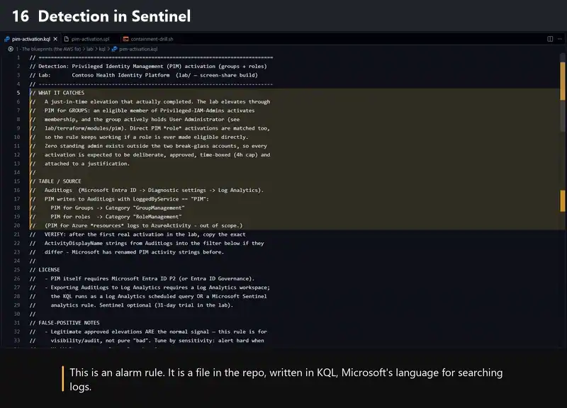

# 16. Detection in Sentinel

Detect and respond · [Contoso Health Identity Lab](../../README.md)

**A detection rule, written as code, finds an admin activation and opens an incident in Microsoft Sentinel.**

[Full clip, 1:03](../videos/N06-the-cameras.mp4)

---

[← 15. Audit evidence](15-audit-evidence.md) · [All chapters](../../README.md) · [17. Detection in Splunk →](17-detection-in-splunk.md)
