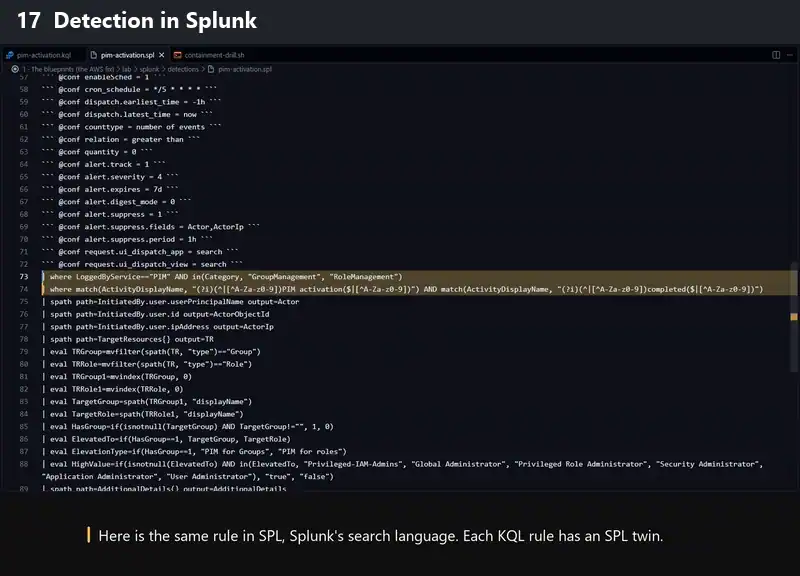

# 17. Detection in Splunk

Detect and respond · [Contoso Health Identity Lab](../../README.md)

**The same rules, in the Splunk search language, run on the same tenant logs.**

[Full clip, 0:42](../videos/N07-the-second-camera.mp4)

---

[← 16. Detection in Sentinel](16-detection-in-sentinel.md) · [All chapters](../../README.md) · [18. Contain a compromised account →](18-contain-a-compromised-account.md)
