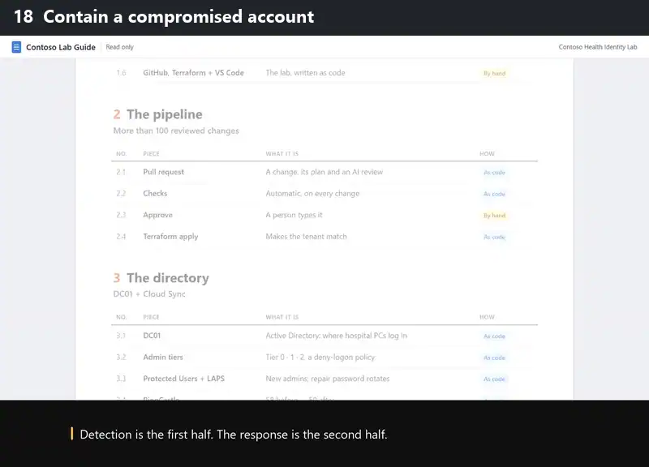

# 18. Contain a compromised account

Detect and respond · [Contoso Health Identity Lab](../../README.md)

**A Sentinel incident asks a named approver in Teams. After the approval, a playbook revokes the sessions and disables the account.**

[Full clip, 1:08](../videos/N22-contain-an-account.mp4)

---

[← 17. Detection in Splunk](17-detection-in-splunk.md) · [All chapters](../../README.md) · [19. Change access with code →](19-change-access-with-code.md)
