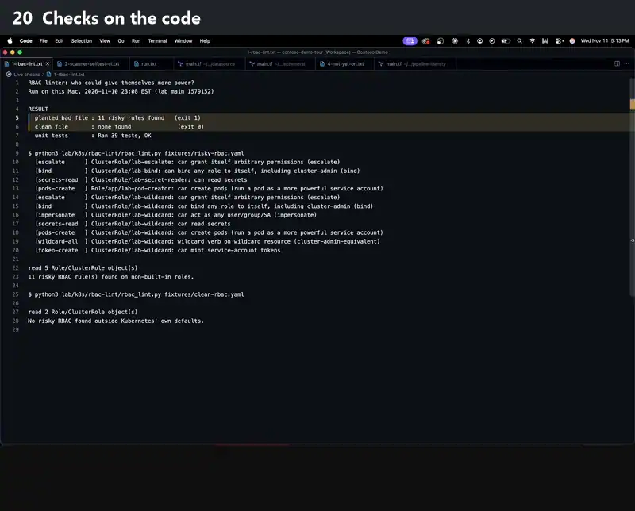

# 20. Checks on the code

Platform as code · [Contoso Health Identity Lab](../../README.md)

**A Kubernetes permission check, and scanners that must fail on an unsafe file before the pipeline trusts them.**

[Full clip, 0:50](../videos/N16-code-checks.mp4)

## Where it lives

| | |
|---|---|
| **Code** | [The scanner self-test](../../lab/pipelines/scanner-selftest/selftest.sh) · [The test workflow](../../.github/workflows/lab-tests.yml) · [The nightly drift check](../../.github/workflows/config-drift.yml) |
| **Test** | [Self-test tests](../../lab/pipelines/scanner-selftest/tests) |
| **Evidence** | [The Kubernetes role check run](../../lab/evidence/k8s-rbac-lint/20261106T071006Z) |
| **Decision** | [ADR 0026: each check is seen to fail](../../lab/docs/adr/0026-positive-controls-every-check-seen-to-fail.md) · [ADR 0021: drift detection](../../lab/docs/adr/0021-configuration-drift-detection.md) |

---

[← 19. Change access with code](19-change-access-with-code.md) · [All chapters](../../README.md) · [21. The lab in VS Code and GitHub →](21-the-lab-in-vs-code-and-github.md)
