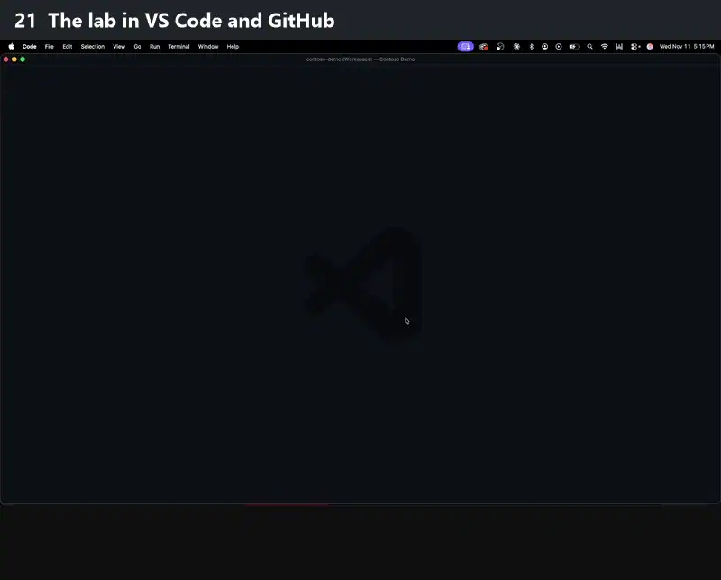

# 21. The lab in VS Code and GitHub

Platform as code · [Contoso Health Identity Lab](../../README.md)

**The code in VS Code, the GitHub Actions runs, the pull requests, and the approval before each apply.**

[Full clip, 0:56](../videos/N17-close-vscode-github.mp4)

---

[← 20. Checks on the code](20-checks-on-the-code.md) · [All chapters](../../README.md) · [22. Move an app from AD FS →](22-move-an-app-from-ad-fs.md)
