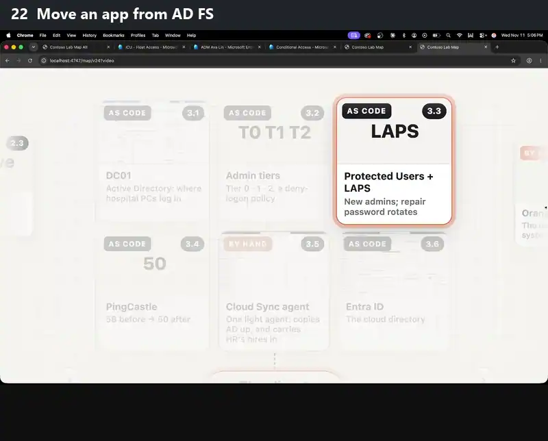

# 22. Move an app from AD FS

Migrations · [Contoso Health Identity Lab](../../README.md)

**One app moves from AD FS, an older sign-in server, to Entra. The build and the tests are complete. The cut-over did not run.**

[Full clip, 1:25](../videos/N13-adfs-to-entra.mp4)

## Where it lives

| | |
|---|---|
| **Code** | [The AD FS exercise](../../lab/adfs/README.md) · [The Entra app (Terraform)](../../lab/terraform/modules/apps/claims_viewer.tf) |
| **Test** | [AD FS tests](../../lab/adfs/tests) |
| **Evidence** | [The sign-ins before the move](../../lab/evidence/adfs-migration/20261107T0131Z) |
| **Decision** | [ADR 0009: how AD FS is retired](../../lab/docs/adr/0009-adfs-to-entra-id-retirement-path.md) |

---

[← 21. The lab in VS Code and GitHub](21-the-lab-in-vs-code-and-github.md) · [All chapters](../../README.md) · [23. Move the clinic from Okta →](23-move-the-clinic-from-okta.md)
